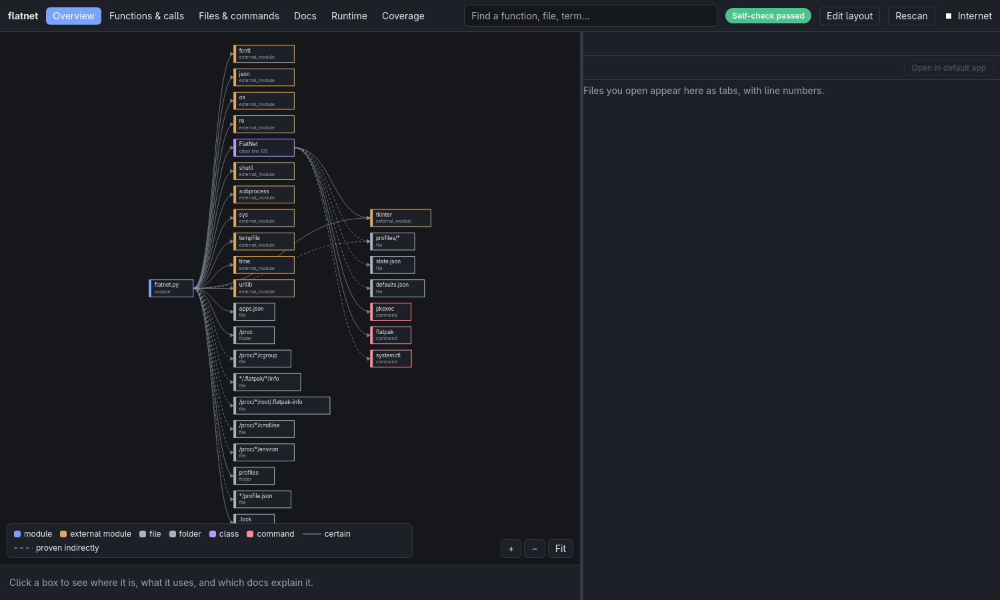
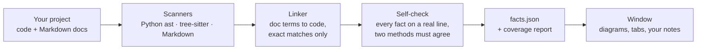
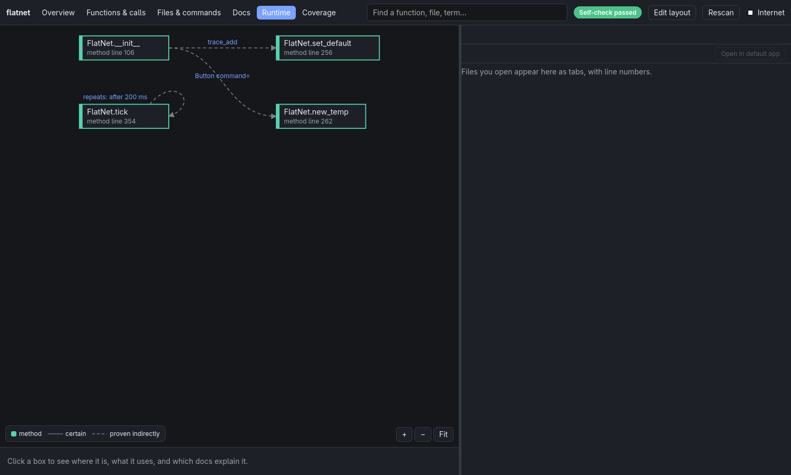

# docmap

**See how a project fits together: diagrams of its code, linked to its docs and to the exact source line, with nothing guessed.**




## What is docmap?

Opening an unfamiliar project usually means reading files one by one and guessing how they connect. docmap reads the project for you and draws it: which files, functions and classes exist, who calls whom, which files and commands the program touches, and which doc explains which part.

Click any box and the source opens at that exact line. Click a word in a doc and you jump to the code it describes.

**Accuracy comes first.** Every box and line comes from a real parser and points to a real line in your code, and a self-check confirms it before anything is shown. If docmap cannot prove something, it does not draw it. It lists it in the Coverage view instead.

| Line | Meaning |
|---|---|
| Solid | Certain: written directly in the code |
| Dashed | Proven in one checkable step, for example a function given to a button |
| *(not drawn)* | Could not be proven. Listed in Coverage with file and line |

## Features

- **Six views:** Overview, Functions & calls, Files & commands, Docs, Runtime (timers, buttons, threads), Coverage
- **Source and docs in tabs** with line numbers, clickable calls and linked terms
- **Self-check badge:** two independent methods must agree, or the window shows exactly where they differ
- **Your own layer:** drag boxes, group them, add notes, labels and your own links. Saved separately, never mixed with the facts
- **Private by default:** works fully offline, and the window's network is blocked until you turn the Internet switch on
- **Optional online lookup:** Wikipedia, Stack Overflow, GitHub and official docs for a term you click (only with Internet on)
- **Simple fallback window** (Tkinter) when WebKitGTK is not installed

## How it works



## Screenshots

| Overview | Runtime |
|---|---|
|  |  |
| Modules, libraries, files and commands | Timers and buttons; a loop means it repeats itself |

## Quick start

Requirements: Linux, Python 3.6 or newer. The full window needs WebKitGTK 4.1 and PyGObject; without them docmap opens a simpler Tkinter window.

```sh
git clone https://github.com/Muzasio/docmap.git
cd docmap
python3 docmap.py setup                 # shows what is missing and how to install it
python3 docmap.py view <project folder> # open the window
```

Optional short command, set up once:

```sh
ln -s "$PWD/bin/docmap" ~/.local/bin/docmap
docmap            # open the current folder
docmap <folder>   # open another folder
```

New to it? The [user guide](docs/USER-GUIDE.md) explains how to read the diagrams and learn a project step by step.

## Supported languages

| Language | Read with | Extra install |
|---|---|---|
| Python | Python's own `ast` | none |
| Markdown docs | docmap's own reader | none |
| Rust, C, C++, C# | tree-sitter | `python3 docmap.py setup --install parsers` (no password, stays inside the docmap folder) |

## Status and roadmap

docmap is usable today and tested, and work on it continues.

**Working**
- Python, Rust, C, C++, C# and Markdown scanning with self-checks
- All six views, tabs, editing layer, fallback window, setup helper, online lookup
- Docs: tables (including escaped `|`) and images stored next to the docs
- Test suite: known answers, hand-written answers per language, and mutation tests that plant mistakes the checker must catch

**Next**
- Report code that no doc mentions, and doc references that no longer match the code
- Link shell commands in docs (for example `` `flatpak info` ``) to the command they run
- Faster drawing and checking for large projects
- Clearer visuals: colored lines per kind, "start here" markers

**Later**
- More languages
- Testing on more Linux distributions

## Documentation

| Document | What is in it |
|---|---|
| [User guide](docs/USER-GUIDE.md) | How to read the diagrams and learn any project, with a worked example |
| [Reference](docs/REFERENCE.md) | Every command, view, setting, output file, limit and troubleshooting tip |

## Running the tests

```sh
python3 tests/run_tests.py
```

Ends with `ALL PASS`. The Rust, C, C++ and C# tests need the parsers (`python3 docmap.py setup --install parsers`).

## Contributing

docmap is at an early stage, so the most helpful contributions right now are **bug reports and feedback**: a project where a diagram looks wrong, a self-check failure, or a step that was confusing. Please open an [issue](https://github.com/Muzasio/docmap/issues) with the steps to reproduce it.

## License

[MIT](LICENSE)
